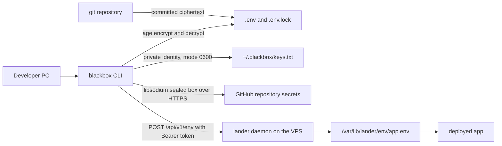
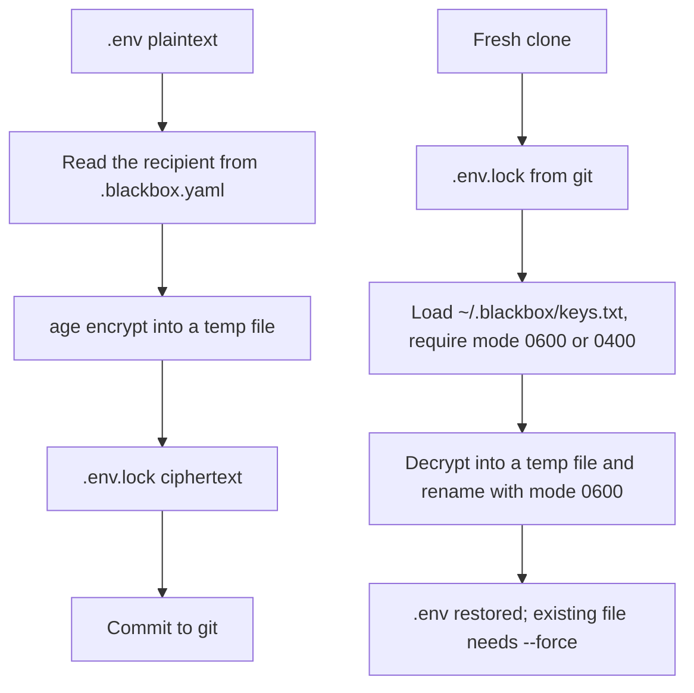
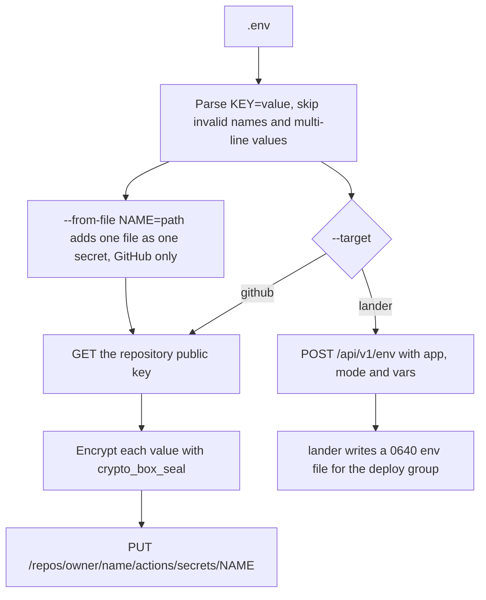

# blackbox

Secrets CLI for the ORBIT Suite: it encrypts `.env` files with [age](https://age-encryption.org) so the ciphertext can be committed, restores them on a trusted machine, and syncs values to GitHub Actions secrets or to a lander daemon without printing them.

Part of ORBIT Suite: [lander](https://github.com/yogaagungk/lander) · [payload](https://github.com/yogaagungk/payload) · [houston](https://github.com/yogaagungk/houston) · [orbit-suite docs](https://github.com/yogaagungk/orbit-suite)

Key features:

- `init` creates an age X25519 identity at `~/.blackbox/keys.txt` (mode `0600`) and a repo-level `.blackbox.yaml` that holds only the public recipient.
- `seal` writes a committable `.env.lock`; `unseal` restores `.env` on a machine that has the private identity.
- `sync --target github` uploads repository secrets with libsodium sealed boxes; `--from-file` handles PEM and `known_hosts` files that should never enter `.env`.
- `sync --target lander` delivers per-app env files to a lander daemon over its write-only `/api/v1/env` endpoint.
- Dry-run by default: the plaintext and key material are never printed or logged, only file names, byte counts and secret names.

## Problem and where it runs

Committing a `.env` leaks every secret, but keeping it only on one laptop breaks CI and the VPS. blackbox splits the problem: the encrypted `.env.lock` lives in git, the private age identity stays on trusted machines, and the values that CI needs are copied into GitHub secrets on demand.

blackbox runs **on the developer's PC or CI runner**, inside the repository it manages. It has no server component. The `sync --target lander` path talks to a lander daemon on the VPS.

## Architecture



### Seal and unseal



### Sync targets



## Quick start

Requirements: the Go toolchain pinned in `go.mod`. GitHub sync needs a token; lander sync needs a lander URL and token.

```sh
make build     # bin/blackbox
make test      # go test -race -count=1 ./...
make vet
make lint
make install   # /usr/local/bin/blackbox
```

Minimal setup in a repository:

```sh
blackbox init
```

Example output (example data):

```text
Initialized blackbox
  keys: /home/you/.blackbox/keys.txt (0600)
  recipient: age1ql3z7k9q8m2v5n4x6c0t7w3s9p1r8d5f2h6j4k8s4w2
  config: .blackbox.yaml
  .gitignore: added .env
```

Seal, commit, restore:

```sh
blackbox seal
blackbox unseal --force
```

Example output (example data):

```text
sealed .env -> .env.lock (212 bytes; recipient age1ql3z7k9q8m...8s4w2)
unsealed .env.lock -> .env (198 bytes)
```

Preview GitHub secrets, then upload them:

```sh
GITHUB_TOKEN=... blackbox sync --target github --repo example-org/orbit-demo
GITHUB_TOKEN=... blackbox sync --target github --repo example-org/orbit-demo --apply
```

Example output (example data):

```text
dry run: would set 4 secrets in example-org/orbit-demo: APP_ENV, DATABASE_URL, DEPLOY_HOST, LOG_LEVEL
set APP_ENV
set DATABASE_URL
set DEPLOY_HOST
set LOG_LEVEL
```

Send an app's env to lander:

```sh
LANDER_TOKEN=... blackbox sync --target lander \
  --url https://lander.example.com --app orbit-demo --apply
```

Example output (example data):

```text
sent 4 env vars to orbit-demo: APP_ENV, DATABASE_URL, DEPLOY_HOST, LOG_LEVEL
```

## Usage reference

Global flags apply to every command:

| Flag | Default | Purpose |
| --- | --- | --- |
| `--config` | `.blackbox.yaml` | Repository config path |
| `--keys` | `~/.blackbox/keys.txt` | age identity file |

| Command | Flags | Purpose |
| --- | --- | --- |
| `blackbox init` | `--force`, `--no-gitignore` | Create the identity and `.blackbox.yaml`; reuse an existing identity in a second repo |
| `blackbox seal` | `--in .env`, `--out .env.lock`, `--dry-run` | Encrypt the plaintext env file |
| `blackbox unseal` | `--in .env.lock`, `--out .env`, `--dry-run`, `--force` | Decrypt with the local identity |
| `blackbox sync` | see below | Copy values to GitHub secrets or lander |
| `blackbox version` | — | Print the version |

`sync` flags:

| Flag | Default | Purpose |
| --- | --- | --- |
| `--target` | `github` | `github` or `lander` |
| `--env` | `.env` | Plaintext env file to read |
| `--apply` | `false` | Perform the upload; without it, list names only |
| `--dry-run` | `false` | List names only; mutually exclusive with `--apply` |
| `--repo` | origin remote | `owner/name` for GitHub |
| `--api` | `https://api.github.com` | GitHub API base; http only on loopback |
| `--from-file` | — | `NAME=path` extra secret, repeatable, GitHub only |
| `--url` | — | lander base URL, required for `--target lander` |
| `--token` | `LANDER_TOKEN` | lander bearer token |
| `--app` | origin repo name | App name for lander |
| `--mode` | `merge` | lander env mode: `merge` or `replace` |

Environment variables:

| Variable | Used by | Purpose |
| --- | --- | --- |
| `GITHUB_TOKEN` | `sync --target github --apply` | PAT with Secrets read/write; a classic PAT needs `repo` |
| `LANDER_TOKEN` | `sync --target lander --apply` | lander bearer token (preferred over `--token`) |

`GITHUB_TOKEN` and `LANDER_TOKEN` can also be entered at a hidden prompt on a terminal; they are never accepted as flags.

## Security notes

- The age identity is written with mode `0600`. `unseal` accepts only `0600` or `0400` identities and refuses files readable or executable by group/others.
- The public recipient comes from the repo-tracked `.blackbox.yaml`; `seal` prints its first and last characters so a swapped recipient is visible before you commit. `.blackbox.yaml` holds no secret.
- `init` reuses an existing machine identity in a second repository. `--force` rotates it and leaves a timestamped `keys.txt.bak-*` backup.
- `.env` is added to `.gitignore` by `init` (unless `--no-gitignore` or you decline the prompt).
- GitHub sync encrypts each value with libsodium `crypto_box_seal` (`nacl/box.SealAnonymous`) using the repository public key. The token comes from `GITHUB_TOKEN` or a hidden prompt, never a flag, and is never written to disk.
- `--api`/`--url` must be https; plain http is accepted only on loopback for local tests, so a copied command cannot send a token over the network.
- Values are never printed or logged. A failure reports the key that failed and how many were already uploaded, not the value.
- Inline `#` comments in `.env` are part of the value and are not stripped. Multi-line quoted values are supported for sealing; lander rejects multi-line and values over 8 KiB on sync, and those keys are skipped with a name-only warning.
- GitHub allows at most 100 repository secrets per repository and 48 KiB per value; blackbox warns but does not block when the count exceeds 100.

## Troubleshooting

| Symptom | Cause and fix |
| --- | --- |
| `identity file /home/you/.blackbox/keys.txt must be 0600 or 0400 (found 0644)` | Tighten the key mode: `chmod 600 ~/.blackbox/keys.txt`. |
| `read .env: file does not exist; run 'blackbox unseal' first` | Restore the plaintext before syncing, or pass `--env` to point at another file. |
| `destination file already exists` | `unseal` will not overwrite `.env`; re-run with `--force` after checking the current file. |
| `.blackbox.yaml already exists; use --force to overwrite` | The repo is already initialized. Use the existing config, or run `init --force` to rotate the identity and rewrite the config. |
| `--url is required for --target lander` | Pass `--url https://lander.example.com` (https, or http only on loopback). |
| `--app "My_App" must match ^[a-z0-9][a-z0-9-]{0,62}$` | App names are lowercase letters, digits and internal hyphens; pass a valid `--app`. |
| `GITHUB_TOKEN is not set and no token was provided on stdin` | Export a PAT with Secrets read/write, or run on a terminal to get the hidden prompt. |
| `no valid secrets found in .env` | Every line was blank, a comment, an invalid key or an oversized value. Check the skipped-entry warning on stderr. |

## Development

```sh
make test     # go test -race -count=1 ./...
make vet
make lint
```

Layout:

```text
cmd/blackbox        cobra commands: init, seal, unseal, sync, version
internal/config     path resolution and .blackbox.yaml loading
internal/domain     config schema
internal/service    key generation, age seal/unseal, env parsing, sealed boxes, GitHub and lander clients
```
